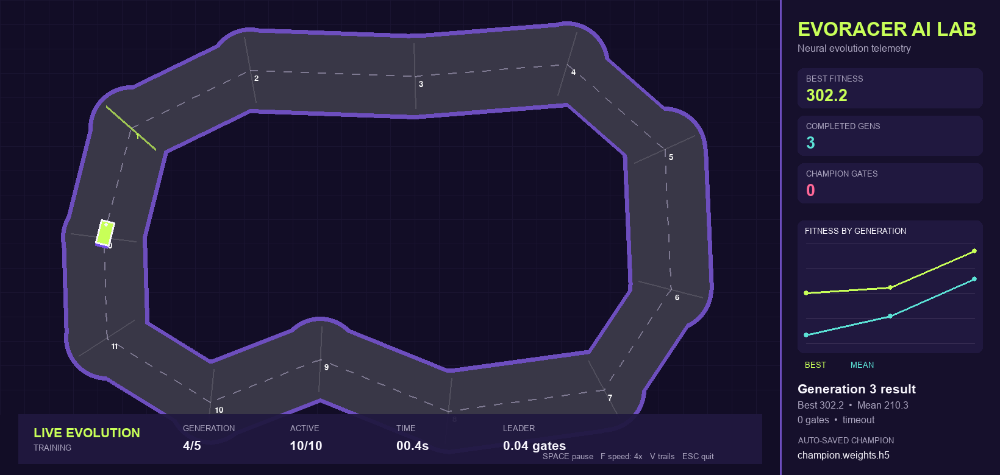
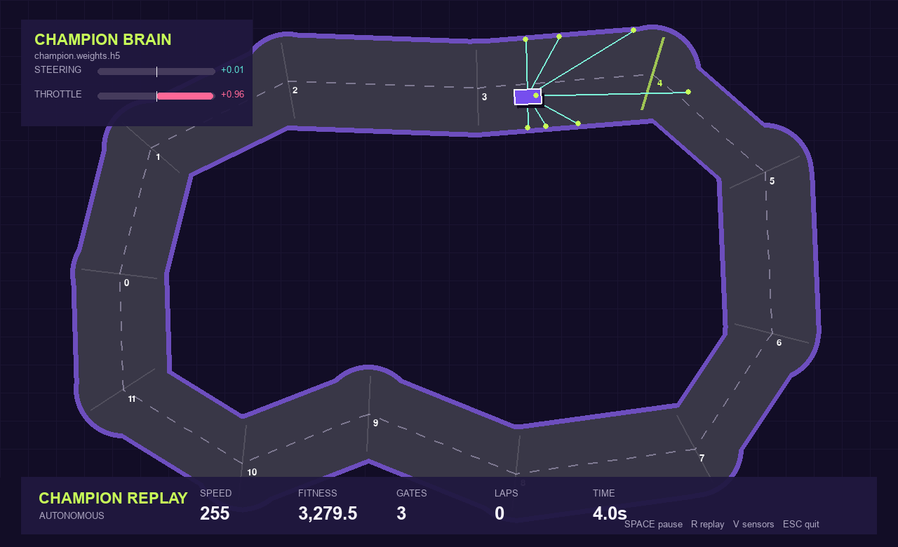
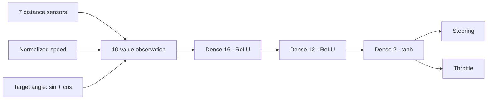
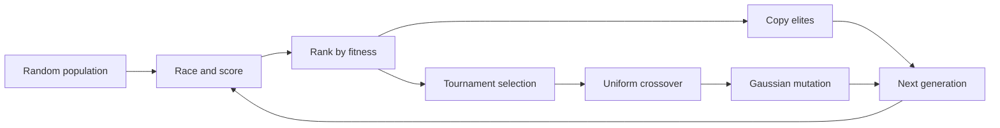

# EvoRacer

EvoRacer is a top-down racing simulator in which a genetic algorithm evolves the weights of a
Keras neural network until it can drive around a closed track. The project uses no labelled
dataset and no backpropagation: every network learns only through simulated racing, fitness,
selection, crossover, and mutation.

The included visual tools show the population learning in real time and replay the saved champion
with its sensor rays and neural-network decisions exposed.

## Demonstration video

[Watch or download the 35-second EvoRacer demonstration](demo/evoracer-demonstration.mp4).

The video shows a real seeded training run, improving best and mean fitness, the saved model/report
artifacts, and the full champion replay ending in a completed lap. Recreate it from the repository
root after training a champion:

```bash
python scripts/create_demo_video.py
```

Use `--champion` or `--output` to select different paths.

## Live genetic training



The training dashboard runs the population together, highlights the current leader, draws driver
trails, and plots best and mean fitness after every generation.

## Champion replay



Replay mode loads the champion's saved Keras weights and displays its seven distance sensors,
steering and throttle outputs, speed, fitness, checkpoints, laps, and final outcome.

## Features

- Deterministic top-down car physics and collision detection
- Closed track with 12 ordered checkpoints and lap counting
- Seven normalized wall-distance sensors
- Compact Keras neural controller with 406 evolvable parameters
- Genetic evolution with elitism, tournament selection, crossover, and mutation
- Smooth checkpoint-based fitness signal and early episode termination
- Live multi-car training dashboard and fitness chart
- Automatic champion weight saving
- Persistent CSV history, JSON summary, and PNG fitness report
- Standalone champion replay with live neural outputs
- Reproducible runs through explicit random seeds

## Neural-network architecture

Each controller receives ten normalized observations:

1. Seven wall-distance sensor readings from -90 to +90 degrees
2. Current speed
3. Sine of the angle to the next checkpoint
4. Cosine of the angle to the next checkpoint

The two outputs are steering and throttle, each bounded to `[-1, 1]` by `tanh`.



Parameter count:

```text
(10 x 16 + 16) + (16 x 12 + 12) + (12 x 2 + 2) = 406
```

The Keras weights are the genome. Crossover combines values from two parent genomes and mutation
adds Gaussian noise to independently selected parameters.

## Fitness function

Progress is continuous rather than checkpoint-only, giving early generations a useful learning
signal:

```text
progress = checkpoints_passed + fractional_progress_toward_next_checkpoint

fitness = max(0,
    1000 * progress
    - 0.25 * elapsed_seconds
    - 50 if crashed
    + 5000 if a lap was completed
    + 25 * remaining_seconds if a lap was completed
)
```

This ordering gives the genetic algorithm clear priorities:

1. Move forward toward the next valid checkpoint.
2. Cross checkpoints in the correct order.
3. Complete a full lap.
4. Complete the lap faster.

An episode ends when the driver completes the target laps, crashes, remains idle for three
seconds, or reaches the time limit. The evaluator remembers maximum forward progress, preventing
a driver from losing all useful fitness after moving backward near the end.

## Genetic algorithm defaults

| Setting | Default | Purpose |
| --- | ---: | --- |
| Population | 30 | Neural drivers evaluated per generation |
| Generations | 25 | Evolution cycles in the visual trainer |
| Elite drivers | 3 | Best genomes copied unchanged with the default population |
| Tournament size | 3 | Candidates competing during parent selection |
| Crossover rate | 85% | Probability of combining two parents |
| Mutation rate | 8% | Probability of mutating each parameter |
| Mutation deviation | 0.15 | Standard deviation of Gaussian mutation noise |
| Episode limit | 30 seconds | Maximum simulated time per generation |
| Seed | 2026 | Makes default experiments reproducible |



## Quick start

Requirements: Python 3.11 or newer. Python 3.12 is recommended.

```bash
git clone https://github.com/ShaharMaaravi/Assignment-3---Training-a-Neural-Network.git
cd Assignment-3---Training-a-Neural-Network
python3 -m venv .venv
source .venv/bin/activate
python -m pip install --upgrade pip
python -m pip install -r requirements.txt
```

Run all commands below from the repository root with `.venv` activated.

## 1. Test the simulator manually

```bash
evo-racer
```

| Key | Action |
| --- | --- |
| Arrow keys or `WASD` | Steer, accelerate, and brake |
| `V` | Show or hide sensor rays |
| `R` | Reset after a crash |
| `Esc` | Quit |

## 2. Train the neural drivers

```bash
evo-racer-train
```

| Key | Action |
| --- | --- |
| `Space` | Pause or resume |
| `F` | Cycle between 1x, 4x, and 12x speed |
| `V` | Show or hide driver trails |
| `Esc` | Quit; completed-generation results remain saved |

Example custom experiment:

```bash
evo-racer-train \
  --generations 40 \
  --population 50 \
  --max-seconds 35 \
  --seed 2026 \
  --output artifacts/run-2/champion.weights.h5 \
  --report-dir artifacts/run-2
```

Giving experiments separate directories prevents a new run from overwriting an existing
champion. See every available option with:

```bash
evo-racer-train --help
```

## 3. Replay the champion

The default command expects `artifacts/champion.weights.h5`. Train a champion first if that file
does not exist.

```bash
evo-racer-replay
```

| Key | Action |
| --- | --- |
| `Space` | Pause or resume |
| `R` | Restart from the starting line |
| `V` | Show or hide sensor rays |
| `Esc` | Quit |

Replay another experiment or request two laps:

```bash
evo-racer-replay \
  --weights artifacts/run-2/champion.weights.h5 \
  --max-seconds 90 \
  --target-laps 2
```

## Training outputs

Training updates these files after every completed generation:

| File | Contents |
| --- | --- |
| `champion.weights.h5` | Best Keras controller weights discovered so far |
| `training_history.csv` | Best, mean, median, and worst fitness per generation |
| `training_summary.json` | Champion result and complete reproducibility configuration |
| `fitness_progress.png` | Standalone best-versus-mean fitness graph |

The `artifacts/` directory is intentionally ignored by Git because these files belong to local
training runs.

## Verified result

The locally trained default champion completed all 12 checkpoints and one full lap in 10.77
simulated seconds, achieving a fitness of 18,281.01. Replay was deterministic when the same saved
weights and simulation settings were used.

## Tests

```bash
pytest
ruff check .
```

The test suite covers geometry, track progress, car physics, neural-controller persistence,
fitness scoring, crossover, mutation, elitism, training sessions, report generation, and champion
replay.

## Project structure

```text
src/evo_racer/
├── car.py           # Physics, sensors, checkpoints, and observations
├── controller.py    # Keras model and genome operations
├── evolution.py     # Selection, crossover, mutation, and generation statistics
├── fitness.py       # Episode evaluation and fitness formula
├── geometry.py      # Segment and projection helpers
├── replay.py        # Testable champion replay state
├── replay_app.py    # Champion replay user interface
├── reporting.py     # CSV, JSON, and PNG report generation
├── simulation.py    # Manual driving mode and shared rendering
├── track.py         # Racetrack geometry, checkpoints, and ray casting
├── training.py      # Live multi-driver training state
└── training_app.py  # Genetic-training dashboard

scripts/
└── create_demo_video.py  # Reproducible MP4 renderer
```
